# Intérprete SQL ESPAÑOL

```
  ___      ___   __    _____  ___    _______  
 |"  \    /"  | |" \  (\"   \|"  \  /"     "| 
  \   \  //   | ||  | |.\\   \    |(: ______) 
  /\\  \/.    | |:  | |: \.   \\  | \/    |          へ♡ ╱|-`♡´-   
 |: \.        | |.  | |.  \    \. | // ___)_    ૮  >  <) (˚ˎ 。7  ִ ࣪𖤐
 |.  \    /:  | /\  |\|    \    \ |(:      "|   /  ⁻  ៸|  |、˜〵   
 |___|\__/|___|(__\_|_)\___|\____\) \_______) 乀(ˍ, ل ل  じしˍ,)ノ⁠♡
 
 MinervaSQL - Intérprete SQL en Español v1.0
```

## 🚀 Cómo Ejecutarlo
```sh
python main.py
```


## Control de Transacciones

El **control de transacciones** te permite agrupar una serie de operaciones de base de datos en una única unidad de trabajo.  
Esto asegura que todas las operaciones se completen con éxito o, si ocurre algún error, que ninguna de ellas se aplique, manteniendo la integridad de tus datos.

---

## BEGIN

El comando **BEGIN** marca el inicio de una nueva transacción.  
Desde este punto, todas las operaciones de modificación de datos (`INSERTAR`, `ACTUALIZAR`, `ELIMINAR`) se registran temporalmente.

### Ejemplo:
```sql
BEGIN;

## Secuencias Actuales
Éstas son las instrucciones reconocidas por el motor (ejemplos que pueden copiarse y probarse, no estrictamente la estructura lógica de las instrucciones, ésta se encuentra en HELP)

```sql
SELECCIONA HR, TEMP DESDE datos;
```
```sql
SELECCIONA * DESDE datos;
```
Pendiente a corregir
```sql
INSERTAR EN datos VALORES (130, 39);
```
```sql
INSERTAR EN datos (HR, TEMP) VALORES (100, 37.1);
```
```sql
SELECCIONA NOMBRE, EDAD DESDE empleados DONDE DEPARTAENTO = 1 ORDENAR POR EDAD ASC;
```
```sql
SELECCIONA NOMBRE, EDAD DESDE empleados DONDE DEPARTAENTO = 1 ORDENAR POR EDAD DESC;
```
```sql
ACTUALIZAR datos CON HR = 95 DONDE TEMP = 36.5;
```
```sql
BORRAR DE datos DONDE HR EQ 90;
```
```sql
DESHACER datos;
```
```sql
CONTAR DESDE datos;
```
```sql
CREAR TABLA pacientes (ID, NOMBRE, EDAD);
```
```sql
USAR BASE datos;
```
```sql
CREAR BASE laboratorio;
```
```sql
CREAR USUARIO fernando PARA 1234
```
```sql
LOGIN fernando PARA 1234
```
```sql
ELIMINAR USUARIO fernando
```
```sql
MOSTRAR BASES
```
```sql
MOSTRAR TABLAS
```
```sql
MOSTRAR USUARIOS
```
```sql
USUARIO_ACTUAL;
```
```sql
ELIMINAR BASE oficina;
```
```sql
BASE_ACTUAL;
```
```sql
HELP
```
```sql
SALIR
```
```sql
MODO DEPURACION
```
## Permisos
```sql
OTORGAR ver_bases A fernando;
```
```sql
OTORGAR otorgar A fernando;
```
```sql
OTORGAR ver_tablas A fernando;
```
```sql
OTORGAR insertar A fernando;
```
```sql
OTORGAR usar_base A fernando;
```
```sql
OTORGAR ver_usuarios A fernando;
```
```sql
OTORGAR crear_base A fernando;
```
```sql
OTORGAR actualizar A fernando;
```
```sql
OTORGAR contar A fernando;
```
```sql
OTORGAR eliminar A fernando;
```
```sql
OTORGAR crear_tabla A fernando;
```
```sql
OTORGAR eliminar_tabla A fernando;
```
### Retirar los permisos
```sql
REVOCAR ver_bases A fernando;
```
```sql
REVOCAR otorgar A fernando;
```
```sql
REVOCAR ver_tablas A fernando;
```
```sql
REVOCAR insertar A fernando;
```
```sql
REVOCAR usar_base A fernando;
```
```sql
REVOCAR ver_usuarios A fernando;
```
```sql
REVOCAR crear_base A fernando;
```
```sql
REVOCAR actualizar A fernando;
```
```sql
REVOCAR contar A fernando;
```
```sql
REVOCAR eliminar A fernando;
```
```sql
REVOCAR crear_tabla A fernando;
```
```sql
REVOCAR eliminar_tabla A fernando;
```
```sql
REVOCAR crear_tabla A karla;
```
```sql
REVOCAR ver_bases A karla;
```
## Explicación

La siguiente tabla da una breve decripción de los permisos que se pueden asignar a los usuarios.
| Permiso | Descripción |
|---------|-------------|
| ver_bases | Listar todas las bases de datos |
| otorgar | Asignar permisos a usuarios |
| ver_tablas | Mostrar tablas de una base |
| insertar | Añadir nuevos registros |
| usar_base | Seleccionar una base para trabajar |
| ver_usuarios | Listar usuarios existentes |
| crear_base | Crear nuevas bases de datos |
| actualizar | Modificar registros existentes |
| contar | Obtener cantidad de registros |
| eliminar | Borrar registros |
| crear_tabla | Crear nuevas tablas |
| eliminar_tabla | Eliminar tablas existentes |

## Léxico Actual
```python
TOKEN_PATTERNS = [
    (r'\bSELECCIONA\b', 'SELECCIONA'),
    (r'\bBORRAR\b', 'ELIMINAR'),
    (r'\bDESDE\b', 'DESDE'),
    (r'\bDONDE\b', 'DONDE'),
    (r'\bINSERTAR\b', 'INSERT'),
    (r'\bEN\b', 'INTO'),  
    (r'\bUSUARIO_ACTUAL\b', 'CURRENT_USER'),
    (r'\bBASE_ACTUAL\b', 'CURRENT_DATABASE'),
    (r'\bVALORES\b', 'VALUES'),  
    (r'\bUSAR\b', 'USE'),
    (r'\bBASE\b', 'DATABASE'),
    (r'\bBASES\b', 'DATABASES'),
    (r'\bMOSTRAR\b', 'SHOW'),
    (r'\bOTORGAR\b', 'GRANT'),
    (r'\bA\b', 'TO'),
    (r'\bMOSTRAR\b', 'MOSTRAR'),
    (r'\bTABLAS\b', 'TABLES'),
    (r'\bUSUARIO\b', 'USER'),
    (r'\bPARA\b', 'WITH'),
    (r'\bCREAR\b', 'CREATE'),
    (r'\bLOGIN\b', 'LOGIN'),
    (r'\bUSUARIO\b', 'USUARIO'),
    (r'\bUSUARIOS\b', 'USUARIOS'),
    (r'\bACTUALIZAR\b', 'ACTUALIZAR'),  
    (r'\bCREAR\b', 'CREATE'),
    (r'\bCON\b', 'SET'),
    (r'\bTABLA\b', 'TABLE'),
    (r'\bDESHACER\b', 'DESHACER'),
    (r'\bELIMINAR\b', 'DELETE'),
    (r'\bDE\b', 'FROM'),
    (r'\bCONTAR\b', 'COUNT'),
    (r'\bEQ\b', '='),
    (r'[a-zA-Z_][a-zA-Z0-9_]*', 'IDENTIFIER'),
    (r'\d+\.\d+', 'FLOAT'),
    (r'\d+', 'NUMBER'),  # Asegura que los valores flotantes también se manejen
    (r"\*", "ASTERISK"),
    (r'>', 'GT'),
    (r'<', 'LT'),
    (r'=', 'EQ'),
    (r',', 'COMMA'),
    (r';', 'SEMICOLON'),
    (r'\(', 'PARIZQ'),
    (r'\)', 'PARDER'),
    (r'(".*?"|\'.*?\')', 'STRING'),
    (r'\s+', None)  # Espacios en blanco que se ignoran
]

```
## A considerar
Interprete basado en SQL Español.
Algunas reglas y aspectos relevantes:

- Las consultas como promedio, suma, entre otras, se realizan por Medio de codigo externo.
- Los tipos de datos en insersion son de tipo FLOAT, INT y STRING.
- La eliminacion de usuarios se maneja desde el archivo de control.
- Los archivos de base de datos estan en la carpeta **database**.
- Los archivos de base de datos se generan con extensión JSON.
- El gestor tiene su propio motor de depuración.
- El usuario root no se puede borrar.
- El usuario root se carga con el primer inicio de sesion, después pueden crearse usuarios loguearse.
- El usuario root es administrador y tiene todos los permisos disponibles.
- El ";"es opcional en la mayoria de instrucciones, solo necesario cuando hay una instruccioque tiene - la ntencion de perdurar.
- El motor es sensible a mayusculas y minusculas.
- Todas las palabras reservadas se escribiran en mayusculas.
- El modo de depuración se activa y desactiva con la misma instrucción (MODO DEPURACION)
- El modo de depuración explica en texto plano el debbugin.
- No pueden revocarse permisos, seria neceario modificarlos desde JSON

## Respaldos cifrados SSH 
El proceso para crear respaldos de las bases de datos es el siguiente.

Para usar el respaldo por medio de ssh es necesario establecer una clave para ejecutar los scripts. Dicha clave se generara con el uso del siguiente comando.

```sh
ssh-keygen -t rsa -b 4096 -C "usuario@ip_usuario"
```
Tanto la ruta como la passphrase se recomienda dejar en default. Despues de creada la llave, se copia al servidor. Si se tiene un puerto diferente del 22, debe especificarse con -p y ser el mismo que el servidor escucha.
```sh
ssh-copy-id -p 5000 servidor@ip_servidor
```
Para comenzar con el uso de los comandos, deben darse permisos de ejecucion **como comando** a los scripts dentro de la carpeta ssh-backup.

```sh
chmod +x ssh-backups/descargar_respaldo.sh
```
```sh
chmod +x ssh-backups/enviar_bases.sh
```
```sh
chmod +x ssh-backups/restaurar_base.sh
```
### Comandos para el BACKUP
Para realizar una copia de seguridad de todas las bases de datos comprimida y encriptada en el servidor :
```sh
./ssh-backups/enviar_bases.sh servidor /home/servidor/backups
```

Para realizar una copia de seguridad de una base de datos especifica comprimida y encriptada en el servidor.
```sh
./ssh-backups/enviar_bases.sh servidor /home/servidor/backups "" "" "" nombre_base
```

En caso de querer descargar (no restaura inmediatamente, unicamente descarga) una base de datos desde el servidor a la carpeta backups:
```sh
./ssh-backups/descargar_respaldo.sh ferna /home/ferna/backups/laboratorio.tar.gz.gpg localhost ./backups/respaldo_recibido
```
Para restaurar una base de datos en el sistema desde la carpeta backups:
```sh
 ./ssh-backups/restaurar_base.sh ./backups/respaldo_recibido ./databases
```

## Ejemplo de los resultados esperados
NOTA: Por cuestiones de seguridad, se pedira clave en cada operacion. A continuacion se muestra la ejecucion esperada de los scripts.

```sh
usuario@CLIENTE:~$ cd biometric_interpreter
usuario@CLIENTE:~/biometric_interpreter$ ./ssh-backups/enviar_bases.sh servidor /home/servidor/backups
⏳ Empaquetando base de datos: default
🔐 Cifrando default.tar.gz
🚀 Enviando default.tar.gz.gpg a servidor@ip_servidor:/home/servidor/backups usando llave ~/.ssh/id_rsa
default.tar.gz.gpg                                                        100%  192   106.5KB/s   00:00
🧹 Limpiando archivos temporales
✅ Base default procesada.
⏳ Empaquetando base de datos: laboratorio
🔐 Cifrando laboratorio.tar.gz
🚀 Enviando laboratorio.tar.gz.gpg a servidor@ip_servidor:/home/servidor/backups usando llave ~/.ssh/id_rsa
laboratorio.tar.gz.gpg                                                    100%  386   480.7KB/s   00:00
🧹 Limpiando archivos temporales
✅ Base laboratorio procesada.
usuario@CLIENTE:~/biometric_interpreter$ ./ssh-backups/enviar_bases.sh servidor /home/servidor/backups "" "" "" laboratorio
⏳ Empaquetando base de datos: laboratorio
🔐 Cifrando laboratorio.tar.gz
🚀 Enviando laboratorio.tar.gz.gpg a servidor@ip_servidor:/home/servidor/backups usando llave ~/.ssh/id_rsa
laboratorio.tar.gz.gpg                                                    100%  386   224.9KB/s   00:00
🧹 Limpiando archivos temporales
✅ Base laboratorio procesada.
usuario@CLIENTE:~/biometric_interpreter$ ./ssh-backups/descargar_respaldo.sh servidor /home/servidor/backups/laboratorio.tar.gz.gpg host ./backups/respaldo_recibido
📥 Descargando /home/servidor/backups/laboratorio.tar.gz.gpg desde servidor@ip_servidor:5000 a ./backups/respaldo_recibido...
laboratorio.tar.gz.gpg                                                    100%  386   183.9KB/s   00:00
✅ Descarga completada.
usuario@CLIENTE:~/biometric_interpreter$  ./ssh-backups/restaurar_base.sh ./backups/respaldo_recibido ./databases
🔓 Descifrando ./backups/respaldo_recibido...
gpg: AES256.CFB encrypted data
gpg: encrypted with 1 passphrase
📦 Extrayendo ./backups/respaldo_recibido en ./databases...
🧹 Eliminando temporal: ./backups/respaldo_recibido
✅ Restauración completada en ./databases

```

## Árbol sintáctico

```mermaid
graph TD
    ROOT[RAÍZ] --> SELECT
    ROOT --> INSERT
    ROOT --> UPDATE
    ROOT --> DELETE
    ROOT --> UNDO
    ROOT --> COUNT
    ROOT --> CREATE_TABLE
    ROOT --> USE_DB
    ROOT --> CREATE_DB
    ROOT --> CREATE_USER
    ROOT --> LOGIN
    ROOT --> DROP_USER
    ROOT --> SHOW
    ROOT --> CURRENT
    ROOT --> DROP_DB
    ROOT --> HELP
    ROOT --> EXIT
    ROOT --> DEBUG
    ROOT --> GRANT
    ROOT --> REVOKE
    ROOT --> TX_BEGIN
    ROOT --> TX_COMMIT
    ROOT --> TX_ROLLBACK

    %% --- GESTIÓN DE PERMISOS (GRANT/REVOKE) ---
    PERMISSION_NAME[PERMISO] --> ver_bases
    PERMISSION_NAME --> otorgar
    PERMISSION_NAME --> ver_tablas
    PERMISSION_NAME --> insertar
    PERMISSION_NAME --> usar_base
    PERMISSION_NAME --> ver_usuarios
    PERMISSION_NAME --> crear_base
    PERMISSION_NAME --> actualizar
    PERMISSION_NAME --> contar
    PERMISSION_NAME --> eliminar
    PERMISSION_NAME --> crear_tabla
    PERMISSION_NAME --> eliminar_tabla

    GRANT --> GRANT_INSTR
    GRANT_INSTR[OTORGAR] --> PERMISSION_NAME
    GRANT_INSTR --> USER_GRANT[A USUARIO]

    REVOKE --> REVOKE_INSTR
    REVOKE_INSTR[REVOCAR] --> PERMISSION_NAME
    REVOKE_INSTR --> USER_REVOKE[DE USUARIO]

    %% --- TRANSACCIONES ---
    TX_BEGIN[BEGIN] --> CMD_BEGIN
    TX_COMMIT[COMMIT] --> CMD_COMMIT
    TX_ROLLBACK[ROLLBACK] --> CMD_ROLLBACK

    %% --- SELECT CON WHERE Y ORDENAR POR ---
    SELECT --> SELECT_COLS
    SELECT_COLS[SELECT: Columnas] --> COL_LIST
    SELECT_COLS --> TABLE_NAME_SEL
    SELECT_COLS --> WHERE_CLAUSE
    SELECT_COLS --> ORDER_CLAUSE

    SELECT --> SELECT_A
    SELECT_A[SELECT: Asterisco] --> ASTERISK
    SELECT_A --> TABLE_NAME_ALL_SEL
    SELECT_A --> WHERE_CLAUSE
    SELECT_A --> ORDER_CLAUSE

    WHERE_CLAUSE[DONDE] --> WHERE_COND_SELECT

    ORDER_CLAUSE[ORDENAR POR] --> ORDER_COL
    ORDER_COL --> ORDER_DIR_ASC[ASC]
    ORDER_COL --> ORDER_DIR_DESC[DESC]

    %% --- INSERCIÓN ---
    INSERT --> INSERT_VALS
    INSERT_VALS[INSERT: Valores] --> TABLE_NAME_INSERT
    INSERT_VALS --> VALUE_LIST
    
    INSERT --> INSERT_COLS
    INSERT_COLS[INSERT: Columnas] --> TABLE_NAME_INSERT_COLS
    INSERT_COLS --> COLUMN_LIST
    INSERT_COLS --> VALUE_LIST_COLS

    %% --- OTROS COMANDOS ---
    UPDATE --> TABLE_UPDATE
    UPDATE --> SET_CLAUSE
    UPDATE --> WHERE_COND_UPDATE

    DELETE --> TABLE_DELETE
    DELETE --> WHERE_COND_DELETE

    UNDO --> UNDO_TABLE

    COUNT --> COUNT_TARGET
    COUNT --> COUNT_SOURCE

    CREATE_TABLE --> TABLE_NAME_CREATE
    CREATE_TABLE --> TABLE_COLS

    USE_DB --> DB_NAME_USE

    CREATE_DB --> DB_NAME_CREATE

    CREATE_USER --> USER_NAME
    CREATE_USER --> USER_PASS

    LOGIN --> LOGIN_USER
    LOGIN --> LOGIN_PASS

    DROP_USER --> DROP_USER_NAME

    SHOW --> SHOW_DBS
    SHOW_DBS --> CMD_SHOW_DB
    SHOW --> SHOW_TABLES
    SHOW_TABLES --> CMD_SHOW_TABLES
    SHOW --> SHOW_USERS
    SHOW_USERS --> CMD_SHOW_USERS

    CURRENT --> CURRENT_USER
    CURRENT_USER --> CMD_CURRENT_USER
    CURRENT --> CURRENT_DB
    CURRENT_DB --> CMD_CURRENT_DB

    DROP_DB --> DROP_DB_NAME

    HELP --> HELP_CMD

    EXIT --> EXIT_CMD

    DEBUG --> DEBUG_CMD
```


    
